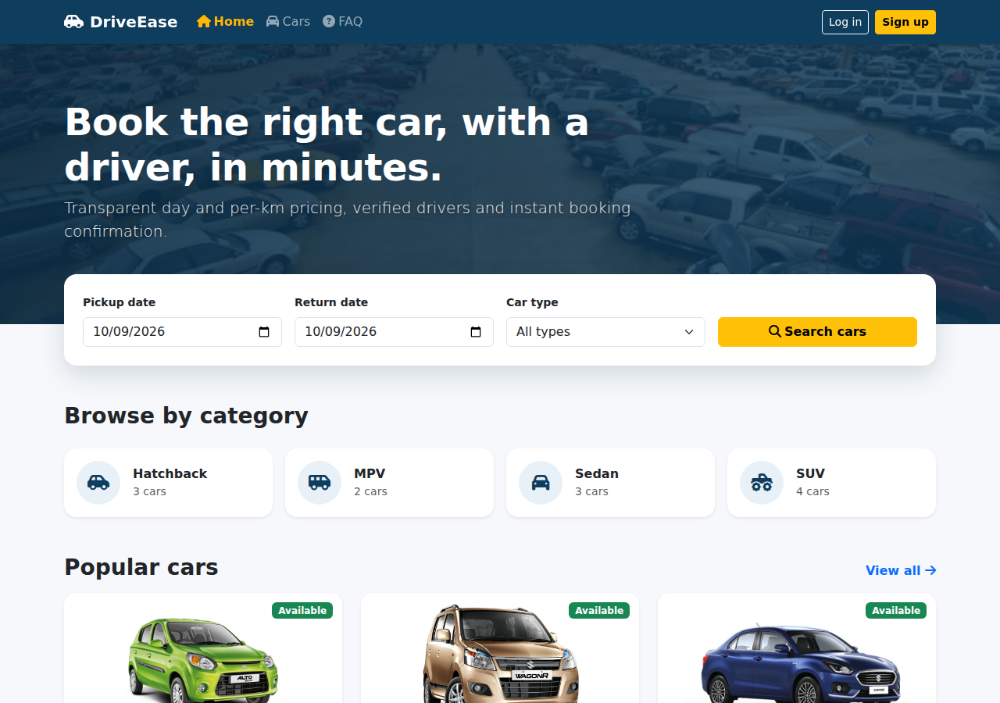
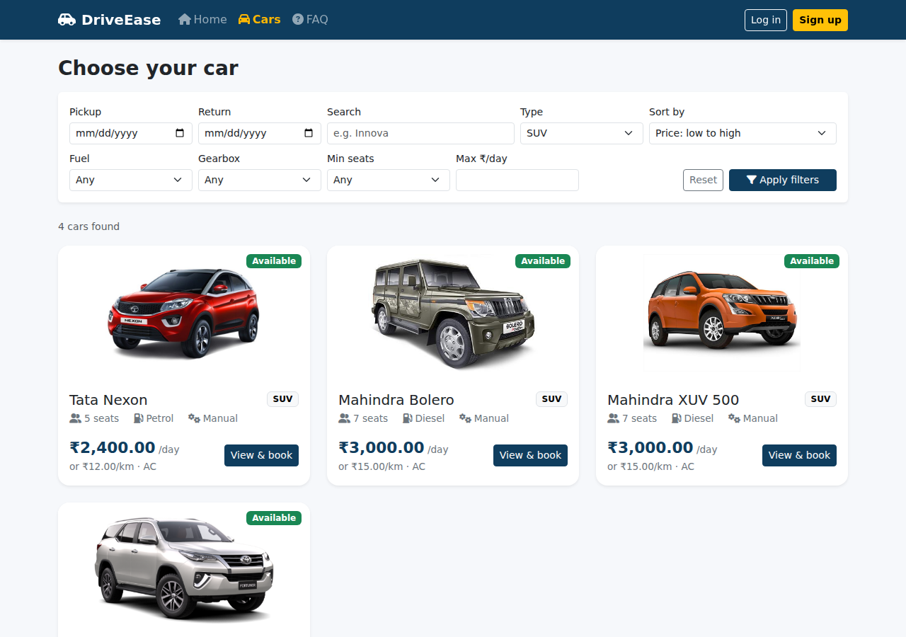
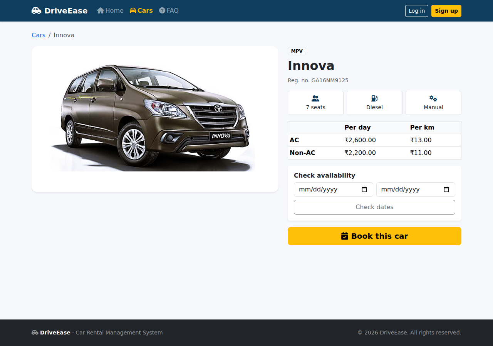
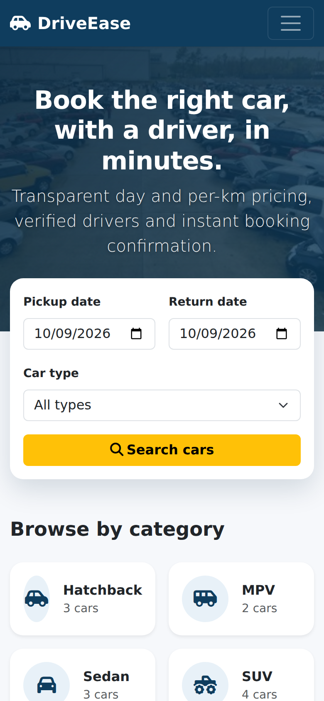
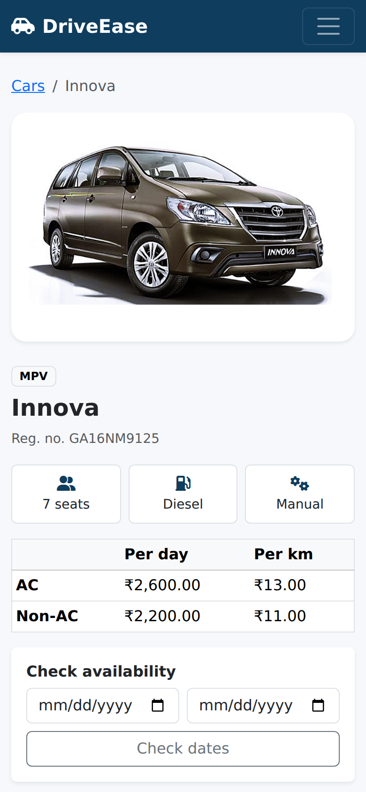

# DriveEase – Car Rental Management System

A web-based platform for car booking and rental management: vehicles, drivers, customers, bookings and payments, with separate experiences for **customers** and **fleet owners (admins)**.

DriveEase is an in-place upgrade of [Patna-Car-Rental](https://github.com/nikhil-amin/Patna-Car-Rental). It keeps **PHP + MySQL**, keeps the original database and its data, and modernises security, structure and UI one phase at a time. It deliberately does *not* move to a framework.

| | |
|---|---|
| **Stack** | PHP 8.x · MySQL / MariaDB · Bootstrap 5 · JavaScript · Font Awesome · SweetAlert2 |
| **Architecture** | Plain PHP, modular `includes/`, prepared statements, no framework, no Composer |
| **Status** | Phases 1–3 of 7 complete (see [Project status](#project-status)) |

**Guides:** [🖥️ XAMPP setup](docs/XAMPP.md) · [🌐 Hosting (cPanel, Ubuntu + Apache, Ubuntu + Nginx)](docs/HOSTING.md)



<p>
  
  
</p>
<p>
  
  
</p>

---

## Table of contents

1. [Project status](#project-status)
2. [Features](#features)
3. [Requirements](#requirements)
4. [Installation](#installation)
5. [Configuration](#configuration)
6. [Database](#database)
7. [Demo accounts](#demo-accounts)
8. [Roles and permissions](#roles-and-permissions)
9. [Security](#security)
10. [Booking, availability and pricing rules](#booking-availability-and-pricing-rules)
11. [Project structure](#project-structure)
12. [Developer guide](#developer-guide)
13. [Testing](#testing)
14. [Production deployment checklist](#production-deployment-checklist)
15. [Troubleshooting](#troubleshooting)
16. [Roadmap](#roadmap)
17. [What changed from the original project](#what-changed-from-the-original-project)
18. [Credits and license](#credits-and-license)

---

## Project status

The upgrade is being delivered in phases. This table is the source of truth for what is finished.

| Phase | Scope | Status |
|---|---|---|
| 1 | Analysis of the original code and database | ✅ Done |
| 2 | Secure foundation: config, prepared-statement DB layer, sessions, CSRF, validation, role auth, additive DB migration | ✅ Done |
| 3 | `public/` web root, Bootstrap 5 UI, homepage, car search/filter/details, availability checking, unified login and registration | ✅ Done |
| 4 | Booking: date selection, server-side fare calculation, driver assignment, transactional availability checks, statuses and cancellation | ✅ Core flow implemented |
| 5 | Owner-scoped vehicle/driver management, customer history and fleet rental ledger | 🟡 Core flows implemented; end-to-end verification pending |
| 6 | Return flow, final invoices, partial/full payment ledger | 🟡 Core flow implemented; reports/refunds pending |
| 7 | Security audit, obsolete route review and full end-to-end regression pass | ⏳ In progress |

**Current status:** booking, cancellation, return, invoices, customer history, fleet-owner rentals/payments, owner-scoped vehicle/driver management, CSV export, and date-filtered monthly revenue and vehicle-performance reports are implemented. CI now runs PHP syntax checks plus database-free lifecycle regression checks. Live-database and full end-to-end tests still need to be run before treating this as production-ready.

---

## Features

### Available now (rebuilt)

**Public site**
- Responsive homepage: hero with date/type search, category tiles with live counts, popular cars, "how it works", live statistics, contact form
- Car listing with keyword search; filters for category, fuel, gearbox, minimum seats and maximum price per day; sorting; pagination
- Per-date availability badges (Available / Booked) based on real booking date overlap
- Car details: specifications, AC / non-AC price table (per day and per km), availability checker, upcoming booked dates, booking call-to-action
- FAQ page

**Accounts**
- One login page and one registration page, each with *Customer* and *Fleet owner* tabs
- Passwords hashed with `password_hash()` and verified with `password_verify()`; old hashes are upgraded automatically on login
- Brute-force protection, session hardening, CSRF protection, server-side validation, POST-only logout
- Role-aware navigation

**Data**
- Original data preserved; additive, repeatable migration
- Vehicle categories, seats, fuel type, transmission; booking status, payment status and times; a payments ledger

### Fleet operations
- Add and edit vehicles with validated rates, specifications and registration numbers.
- Activate or deactivate vehicles without deleting records; deactivation is blocked while a trip is active.
- Add and edit drivers with validated licence/contact details.
- Activate or deactivate drivers without deleting records; deactivation is blocked while a trip is active.
- Fleet lists and edit actions are scoped to the signed-in fleet owner; status-changing forms require CSRF tokens.
- Export the full fleet rental ledger to CSV for spreadsheet reporting; exports are owner-scoped and protect spreadsheet cells from formula injection.

### Remaining work
Live-database and end-to-end tests, further audit of inherited utility routes, advanced date-filtered reports, refunds, and payment-gateway integration remain planned. Manual payment recording is not a payment gateway. See the [Roadmap](#roadmap).

---

## Requirements

| Component | Version | Notes |
|---|---|---|
| PHP | **8.1 or newer** (developed and tested on 8.3) | Extensions: `mysqli`, `mbstring`, `json`, `session` |
| MySQL / MariaDB | MySQL 5.7+ / MariaDB 10.3+ expected (tested on MariaDB 10.11) | InnoDB, `utf8mb4` |
| Web server | Apache (with `mod_rewrite` for the fallback), Nginx, or PHP's built-in server for development | |
| Browser | Any current browser | |
| Node.js / Composer | **Not required** | Frontend libraries are vendored in the repository |

Frontend libraries are bundled locally (no CDN calls, no external requests): Bootstrap **5.3.8**, Font Awesome **6.7.2**, SweetAlert2 **11.26.25**.

---

## Installation

### 1. Get the code

Use the upgraded project folder (unzip the delivered archive, or clone the repository once the upgrade branch has been pushed to it):

```bash
git clone <your-repository-url> driveease
cd driveease
git checkout driveease-upgrade      # the upgrade branch; skip if you unzipped the archive
```

### 2. Create the database and a dedicated user

Avoid running the app as MySQL `root`.

```sql
CREATE DATABASE carrental CHARACTER SET utf8mb4 COLLATE utf8mb4_unicode_ci;
CREATE USER 'driveease'@'localhost' IDENTIFIED BY 'a-strong-password';
GRANT ALL PRIVILEGES ON carrental.* TO 'driveease'@'localhost';
FLUSH PRIVILEGES;
```

(`ALL` is needed because the migration alters tables. After migrating you can reduce it to `SELECT, INSERT, UPDATE, DELETE`.)

### 3. Configure

```bash
cp .env.example .env
```

Edit `.env` and set `DB_USER` / `DB_PASS` (see [Configuration](#configuration)).

### 4. Load the data

**New installation** — import the original schema and sample data, then migrate:

```bash
mysql -u driveease -p carrental < database/carrental.sql
php database/migrate.php
```

**Existing installation** (you already run the original Patna-Car-Rental) — back up first, then migrate in place:

```bash
mysqldump -u root -p carrental > backup-before-driveease.sql
php database/migrate.php
```

The migration is **additive and idempotent**: it never drops tables or data, and running it twice changes nothing. Details in [Database](#database).

You can also import `carrental.sql` with phpMyAdmin (Import tab). The migration itself must be run from the command line (it refuses to run over HTTP).

### 5. Run it

Pick one.

**A. PHP built-in server (quickest, for development)**

```bash
php -S localhost:8000 -t public
```

Open <http://localhost:8000>. Note that this server ignores `.htaccess`, so it is for local use only.

**B. Apache — recommended: point `DocumentRoot` at `public/`**

```apache
<VirtualHost *:80>
    ServerName driveease.local
    DocumentRoot /path/to/driveease/public
    <Directory /path/to/driveease/public>
        AllowOverride All
        Require all granted
    </Directory>
</VirtualHost>
```

This keeps `.env`, `config/`, `includes/` and `database/` **outside** the web root, which is the safest setup.

**C. XAMPP / WAMP (project folder inside `htdocs`)**

Copy the project to `htdocs/driveease` and browse to `http://localhost/driveease/`. The root `.htaccess` rewrites requests into `public/` and blocks `config/`, `includes/`, `database/`, `tests/`, `.git` and `.env` (returns 403). This needs `mod_rewrite` and `AllowOverride All`.

➡️ **Full step-by-step guide: [docs/XAMPP.md](docs/XAMPP.md)** — database import in phpMyAdmin, `.env`, the migration, a safety check, a clean `http://driveease.local` virtual host, upgrading an existing install, phone testing and troubleshooting.

**D. A real server (cPanel, Ubuntu + Apache, Ubuntu + Nginx)**

➡️ **Full guide: [docs/HOSTING.md](docs/HOSTING.md)** — cPanel layout, VPS setup with tested Apache and Nginx configs, HTTPS, Cloudflare, backups and restore, updating, and troubleshooting.

After deploying anywhere, verify it:

```bash
./tests/deploy_check.sh https://your-domain/
```

### 6. Log in

Use the [demo accounts](#demo-accounts), then change their passwords.

---

## Configuration

All configuration lives in `.env` (git-ignored). Real environment variables, if set, override `.env`, which suits Docker and CI.

| Key | Default | Description |
|---|---|---|
| `APP_NAME` | `DriveEase` | Shown in the navbar, page titles and footer |
| `APP_ENV` | `production` | `production` hides errors and logs them; `local` shows detailed errors. **Never use `local` on a public server.** |
| `DB_HOST` | `127.0.0.1` | Database host |
| `DB_PORT` | `3306` | Database port (XAMPP is often `3307` when another MySQL exists) |
| `DB_NAME` | `carrental` | Database name |
| `DB_USER` | `root` | Database user (use a dedicated account) |
| `DB_PASS` | *(empty)* | Database password |
| `ALLOW_ADMIN_SIGNUP` | `false` | Public fleet-owner self-registration is disabled by default. Set `true` only for controlled development; create production owners with the CLI tool |

Other settings are in code: session idle timeout (30 minutes), login lockout (5 failed attempts, 15 minutes) in `includes/security.php`; time zone (`Asia/Kolkata`) in `includes/bootstrap.php`.

URLs are generated relative to `public/`, so the app works at a domain root or in a sub-folder with no base-URL setting.

---

## Database

The original schema is kept as-is and extended. No table is recreated.

### Tables

| Table | Purpose | Key columns |
|---|---|---|
| `customers` | Customer accounts | `customer_username` (PK), name, phone, email, address, `customer_password` (hash), `created_at` |
| `clients` | **Fleet owners** — the *admin* role | `client_username` (PK), name, phone, email, address, `client_password` (hash), `created_at` |
| `cars` | Vehicles | `car_id`, `car_name`, `car_nameplate` (unique), `car_img`, `ac_price` / `non_ac_price` (per km), `ac_price_per_day` / `non_ac_price_per_day`, **`category`, `seats`, `transmission`, `fuel_type`, `description`, `is_active`** |
| `clientcars` | Which fleet owner owns which car | `car_id`, `client_username` |
| `driver` | Drivers, each belonging to a fleet owner | `driver_id`, `dl_number` (unique), phone, address, gender, `client_username`, `driver_availability`, **`is_active`** |
| `rentedcars` | Bookings | `id`, `customer_username`, `car_id`, `driver_id`, booking / start / end / return dates, `fare`, `charge_type` (`days`/`km`), `distance`, `no_of_days`, `total_amount`, `return_status`, **`pickup_time`, `return_time`, `ac_type`, `booking_status`, `payment_status`, `amount_paid`, `estimated_total`, `late_fee`, `cancelled_at`, `cancel_reason`** |
| `payments` *(new)* | Payment ledger | `booking_id`, `amount`, `method`, `reference`, `status`, `recorded_by`, `paid_at` |
| `login_attempts` *(new)* | Brute-force throttling | `ident`, `ip`, `attempted_at` |
| `feedback` | Contact-form messages | **`id`**, name, e-mail, message, **`created_at`** |

**Bold** columns were added by the upgrade.

### What the migration does

`php database/migrate.php` runs five steps, each guarded so it is safe to repeat:

1. **Accounts** — widens password/e-mail/name/address columns (the originals were `varchar(20)` and `varchar(25)`), then replaces every plaintext password with a bcrypt hash. Existing passwords keep working.
2. **Vehicles** — adds category, seats, transmission, fuel type, description and an active flag. Existing cars are categorised from their names (Hatchback / Sedan / MPV / SUV), with seats and fuel inferred. **These are best-effort values; review them in the vehicle editor when it lands in Phase 5.**
3. **Drivers and feedback** — adds an active flag; gives `feedback` a primary key and timestamp; widens `feedback.message` (was 150 characters) and `cars.car_img`.
4. **Bookings** — adds time, AC type, booking status, payment status and amounts. Existing bookings are backfilled once: returned (`R`) → `completed` + `paid`; not returned (`NR`) → `confirmed` + `unpaid`. A marker column `_migrated` records that the backfill ran. An index on `(car_id, rent_start_date, rent_end_date)` speeds up availability checks.
5. **New tables** — creates `payments` and `login_attempts`, and writes one ledger row per settled historic booking.

> **Assumption:** the original system had no payment tracking, so all previously returned bookings are treated as fully paid. If that is not true for your data, adjust `payment_status` / `amount_paid` after migrating.

After migrating the original sample data you should see 12 cars, 12 bookings, 11 ledger rows, and total revenue unchanged at ₹1,04,482.

### Legacy columns kept for compatibility

`rentedcars.return_status` and `cars.car_availability` / `driver.driver_availability` are still written by the legacy pages. New code decides availability from booking dates and `booking_status`, not from these flags. They are removed or derived in Phase 7.

---

## Demo accounts

The sample data ships with four accounts. All have the password **`root`**, which is stored hashed after migration.

| Role | Username | Name |
|---|---|---|
| Customer | `diwakar` | Diwakar Vignesh |
| Customer | `rakshith` | Rakshith Kotian |
| Fleet owner (admin) | `nikhil` | Nikhil Amin |
| Fleet owner (admin) | `roshan` | Roshan Raj |

> ⚠️ **Change or delete these before any real deployment.** Anyone who has read this file knows the password.

### Account administration (command line)

Until the in-app password and user screens arrive in Phase 5, manage accounts with `database/user.php` (CLI only):

```bash
php database/user.php list
php database/user.php set-password customer diwakar
php database/user.php set-password admin nikhil
php database/user.php create admin myowner "My Name" me@example.com 9876543210 "My City"
```

Passwords must be 8+ characters with a letter and a number, and are stored hashed. For scripts, set `USER_PASSWORD=…` instead of being prompted. Setting a password also clears that account's login lockout.

---

## Roles and permissions

| Role | Table | Can do |
|---|---|---|
| **Guest** | – | Browse cars, search, view details, check availability, read FAQ, send a message, register, log in |
| **Customer** | `customers` | Everything a guest can, plus book cars, return cars, view own rentals and history |
| **Fleet owner (admin)** | `clients` | Manage own vehicles and drivers, view rentals of own cars. Cannot book cars |

Fleet owners are scoped to **their own** cars and drivers (via `clientcars` and `driver.client_username`), exactly as in the original system. Page access is enforced on the server with `require_role()`; hiding a link is never relied on.

---

## Security

### Implemented

| Area | Measure |
|---|---|
| Passwords | `password_hash()` / `password_verify()`; automatic rehash; registration requires 8+ characters with a letter and a number |
| SQL injection | Prepared statements via `db_one()` / `db_all()` / `db_exec()` in all rebuilt code; the sort column is chosen from a fixed whitelist, never from user text |
| CSRF | Per-session token, `hash_equals()` check, HTTP 403 on failure (a standard code, so Apache/XAMPP does not turn it into a 500), on every state-changing form |
| XSS | All output passes through `e()` (`htmlspecialchars`, UTF-8); LIKE wildcards in search are escaped |
| Sessions | HttpOnly, SameSite=Lax, `Secure` on HTTPS (also detected behind a proxy/CDN via `X-Forwarded-Proto`), strict mode, ID regenerated on login (prevents fixation), ID and data cleared on logout, 30-minute idle timeout |
| Brute force | 5 failed attempts per username + IP locks login for 15 minutes; a hash check runs even for unknown usernames so timing does not reveal valid accounts |
| Authorization | Role gate per page; role-specific login tables so a customer cannot sign in as an admin |
| Open redirect | Post-login redirects accept only same-site relative paths |
| Headers | `X-Frame-Options`, `X-Content-Type-Options`, `Referrer-Policy`, `Permissions-Policy` |
| Secrets | No credentials or API keys in code. `.env` is git-ignored and blocked from the web by `.htaccess` and by living outside `public/` |
| Errors | In `production`, exceptions are logged and users see a generic message — no SQL or stack traces |
| Hardening | `config/`, `includes/`, `database/`, `tests/` are not web-reachable; migration and account tools refuse to run outside the CLI; optional `ALLOW_ADMIN_SIGNUP=false` closes public fleet-owner signup |

### Known gaps until Phases 4–6 land

These apply to the **legacy pages** only (`booking.php`, `bookingconfirm.php`, `returncar.php`, `prereturncar.php`, `printbill.php`, `mybookings.php`, `entercar*.php`, `enterdriver*.php`, `clientview.php`):

- Raw / concatenated SQL (injectable)
- No CSRF tokens on their forms
- No ownership checks: a logged-in user can open another user's booking by changing `?id=`
- `printbill.php` trusts the fare posted from the browser
- Car-image upload trusts the client-supplied filename and MIME type

Also not yet in place anywhere: a `Content-Security-Policy` header, audit logging, and two-factor authentication.

### Action required

The original repository **committed a Google Maps API key** (`AIzaSyC…`). The key has been removed from the code, but it remains in git history. **Revoke it in the Google Cloud console and issue a new one** if you ever re-add a map.

### Reporting a vulnerability

Please open a private security advisory on the repository instead of a public issue.

---

## Booking, availability and pricing rules

### Availability (live in the search and details pages)

A car is **unavailable** for a requested range `[start, end]` when any booking for it, in status `confirmed` or `active`, satisfies:

```
booking.start <= requested.end  AND  booking.end >= requested.start
```

- Both ends are **inclusive**; a booking ending on the 12th blocks a new one starting on the 12th.
- Past dates and an end date before the start date are rejected.
- Cancelled and completed bookings never block.
- With no dates chosen, the badge reflects *today*.

### Pricing (legacy behaviour today)

Each car has four rates: **AC / non-AC × per day / per km**.

- `days` charge type: `days × daily rate`
- `km` charge type: `kilometres driven × per-km rate`, entered at return
- **Late return**: ₹200 per extra day beyond the booked end date, added to the final amount

### Planned in Phase 4

- Fare calculated **server-side only** from the stored rates (never from a posted form value)
- An *estimated* fare shown at booking; per-km bookings finalised at return
- Date **and time** selection, AC/non-AC choice, driver assignment from the car owner's available drivers
- Availability re-checked **inside a database transaction** (row locked) so two customers cannot double-book
- Booking status flow: `pending → confirmed → active → completed`, or `cancelled`
- Customer cancellation before pickup, with a reason

### Planned in Phase 6

- Payment status: `unpaid → partial → paid` (and `refunded`) driven by the `payments` ledger
- Printable/PDF invoice and receipt with invoice number `DE-######`
- Reports: bookings, customers, vehicles, revenue

---

## Project structure

```
driveease/
├── public/                    ← web root (point your server here)
│   ├── index.php              Homepage
│   ├── cars.php               Search, filters, sorting, pagination
│   ├── car.php                Car details + availability checker
│   ├── login.php              Unified login (customer / fleet owner)
│   ├── register.php           Unified registration
│   ├── logout.php             POST-only logout
│   ├── contact.php            Contact-form handler
│   ├── faq.php                FAQ
│   ├── connection.php         Legacy shim → secure DB layer
│   ├── booking.php … clientview.php   Legacy pages, replaced in Phases 4–6
│   ├── customerlogin.php, clientlogin.php, customersignup.php, clientsignup.php
│   │                          301 redirects to the new pages (old links keep working)
│   └── assets/
│       ├── css/driveease.css  Theme
│       ├── js/app.js          SweetAlert2 toasts/confirm, date pickers, UX helpers
│       ├── img/               Site and car images
│       ├── vendor/            Bootstrap 5, Font Awesome 6, SweetAlert2 (local)
│       └── ajs, w3css, bootstrap, fonts, js   Legacy libraries, removed in Phase 7
├── includes/                  ← application code (not web-reachable)
│   ├── bootstrap.php          Single entry: config, session, error handling, headers
│   ├── db.php                 Prepared-statement helpers, transactions
│   ├── security.php           Sessions, CSRF, roles, login, throttling
│   ├── validation.php         Rule-based input validation
│   ├── helpers.php            e(), money(), url(), flash(), redirect(), …
│   ├── layout.php             Header/footer, role-aware navbar
│   ├── cars.php               Search, categories, availability
│   └── car_card.php           Car card partial
├── config/config.php          .env loader and config()
├── database/
│   ├── carrental.sql          Original schema + sample data
│   ├── migrate.php            Additive, idempotent upgrade (CLI only)
│   └── user.php               Account admin: list / set-password / create (CLI only)
├── tests/
│   ├── foundation_test.php    Security/validation unit tests (30)
│   ├── phase3_http.sh         End-to-end HTTP tests (64)
│   └── deploy_check.sh        Post-deployment checker for any live URL
├── docs/
│   ├── XAMPP.md               XAMPP guide
│   ├── HOSTING.md             cPanel / Apache / Nginx hosting guide
│   └── screenshots/           README images
├── .env.example               Configuration template
├── .htaccess                  Fallback routing + protection when root is the web root
└── README.md
```

---

## Developer guide

Conventions are small on purpose: plain PHP, one include per concern, no framework.

### Anatomy of a page

```php
<?php
declare(strict_types=1);
require_once __DIR__ . '/../includes/bootstrap.php';   // config, DB, session, headers
require_once __DIR__ . '/../includes/layout.php';

$user = require_role('customer');          // redirects guests, 403s other roles

if (is_post()) {
    csrf_check();                          // 403 if the token is missing/wrong
    [$errors, $in] = validate($_POST, ['note' => 'required|max:200']);
    if (!$errors) {
        db_exec('INSERT INTO notes (owner, body) VALUES (?, ?)', [$user['id'], $in['note']]);
        flash('success', 'Saved.');        // shown as a SweetAlert toast
        redirect(url('notes.php'));        // post/redirect/get
    }
}

render_header('Notes');
?>
<form method="post">
  <?= csrf_field() ?>
  <input name="note" class="form-control">
  <?= field_error($errors ?? [], 'note') ?>
  <button class="btn btn-brand">Save</button>
</form>
<?php render_footer();
```

### Helper reference

| Area | Functions |
|---|---|
| Database | `db_one($sql, $params)`, `db_all()`, `db_value()`, `db_exec()` (affected rows), `db_insert_id()`, `db_transaction(fn)` |
| Auth | `auth_attempt($role, $user, $pass)`, `current_user()`, `is_role()`, `require_role()`, `logout()`, `password_hash_new()` |
| CSRF | `csrf_field()`, `csrf_check()`, `csrf_token()` |
| Validation | `validate($input, $rules)` → `[errors, clean]`. Rules: `required`, `min:n`, `max:n`, `email`, `phone`, `username`, `int`, `numeric`, `positive`, `date`, `time`, `in:a,b`, `password` |
| Output | `e()` (always escape), `money()`, `url()`, `asset()`, `field_error()`, `car_image()` |
| Flow | `flash()`, `redirect()`, `is_post()` |
| Domain | `cars_search()`, `car_is_available()`, `car_find()`, `car_categories()`, `validate_date_range()`, `rental_days()`, `invoice_no()` |

### Rules to follow

1. **Never concatenate user input into SQL.** Use `?` placeholders. Table and column names that must vary come from a whitelist.
2. **Escape every dynamic value** with `e()`.
3. **Every POST handler calls `csrf_check()`** and every protected page calls `require_role()`.
4. **Check ownership, not just role** — e.g. a customer may only touch bookings where `customer_username` is theirs; a fleet owner only cars in `clientcars` under their username.
5. **Compute money on the server** from stored rates.
6. Use `db_transaction()` for multi-statement changes.
7. Add schema changes as new guarded steps in `database/migrate.php`, never by editing the original dump.

---

## Testing

Two suites are included. They need a migrated database configured in `.env`.

```bash
php tests/foundation_test.php      # 30 assertions: auth, injection, throttling, CSRF, validation, helpers
./tests/phase3_http.sh             # 64 assertions: pages, filters, availability boundaries, auth flow, registration, XSS/SQLi, hosting hardening
./tests/deploy_check.sh https://your-domain/    # checks a LIVE deployment (no database access needed)
```

The HTTP suite starts its own PHP server on port 8099 and needs `curl` and the `mysql` client. It creates temporary rows and removes them afterwards.

`deploy_check.sh` is different: run it from any machine against a deployed URL. It verifies that every asset loads, the database connects, **secrets are not downloadable**, headers and cookies are right, and (optionally, with `DE_USER`/`DE_PASS`) sign-in works. It was tested against Apache (sub-folder, virtual host and cPanel layouts) and Nginx + PHP-FPM.

What the other two cover: filters and pagination counts, XSS and SQL-injection payloads, inclusive date-overlap boundaries, CSRF rejection (HTTP 403), login/role isolation/lockout, registration validation and password hashing, logout, legacy-page compatibility, and security headers.

> ⚠️ **Run the tests against a development database only.** They write to `login_attempts` and rewrite a demo account's password hash.

---

## Production deployment checklist

- [ ] `DocumentRoot` points at `public/` (so `.env` is not in the web root)
- [ ] `APP_ENV=production`
- [ ] HTTPS enabled (session cookies then become `Secure` automatically); consider HSTS
- [ ] Dedicated database user, not `root`; privileges reduced after migration
- [ ] Demo accounts changed or deleted
- [ ] Old Google Maps key revoked
- [ ] `.env` readable only by the web user (`chmod 640`)
- [ ] PHP: `display_errors=Off`, errors logged to a file outside the web root
- [ ] Database backups scheduled
- [ ] Remaining legacy vehicle/driver management and utility pages audited and secured before public deployment
- [ ] `tests/` and `database/` not reachable from the web (automatic with option A/B)

---

## Troubleshooting

| Symptom | Likely cause and fix |
|---|---|
| `Connection refused` / white page | Database not running, or wrong `DB_*` in `.env`. Set `APP_ENV=local` temporarily to see the error |
| "Something went wrong" on every page | `APP_ENV=production` is hiding an error; check the PHP error log |
| Login always fails for existing users after upgrading | The migration has not been run (passwords are still plaintext). Run `php database/migrate.php` |
| "Too many failed attempts" | Lockout after 5 bad passwords. Wait 15 minutes, or `DELETE FROM login_attempts;` |
| "Your session expired… (403)" | CSRF token missing or stale — reload the page and retry; check that cookies are enabled |
| Unstyled page / missing icons | The server's document root is not `public/`, so `assets/` 404s. Check the VirtualHost or use the rewrite fallback |
| `.htaccess` has no effect | Enable `mod_rewrite` and set `AllowOverride All`; the PHP built-in server never reads `.htaccess` |
| `Access denied for user` during migration | The DB user lacks `ALTER`/`CREATE`. Grant `ALL` on the database for the migration |
| `Call to undefined function mb_strlen` | Enable the `mbstring` PHP extension |
| `Too many arguments to function mysqli_stmt::execute()` | PHP older than 8.1; upgrade PHP |
| Car images missing | Images referenced in `cars.car_img` must exist under `public/` (e.g. `public/assets/img/cars/…`) |
| Migration prints nothing and exits | It must run on the CLI (`php database/migrate.php`), not in a browser |

---

## Roadmap

**Phase 4 – Booking (core implemented).** Date selection, AC/non-AC choice, server-side fare estimate, driver assignment and transactional double-booking protection are in place. Time selection and customer cancellation remain.

**Phase 5 – Management and dashboards.** Vehicle CRUD with safe image upload (type and size validation, generated filenames); driver management with activate/deactivate; customer list and profile; customer dashboard (active, upcoming, history, spend) and admin dashboard (fleet utilisation, today's pickups/returns, revenue, outstanding payments).

**Phase 6 – Payments, invoices and reports.** Manual payments (cash/UPI/card/bank), partial payments, payment-status updates, printable invoice view, fleet-scoped rental CSV export, and date-filtered monthly revenue/vehicle-performance reports are implemented. Refunds and broader booking/customer reports remain.

**Phase 7 – Cleanup.** Remove Angular, W3.CSS, Bootstrap 3, the old jQuery builds and legacy session bridging; drop reliance on the legacy availability flags; add a `Content-Security-Policy`; finish documentation and a full regression pass.

---

## What changed from the original project

| Original | Now |
|---|---|
| Plaintext passwords in `varchar(20)` | bcrypt hashes in `varchar(255)`, auto-rehash |
| String-built SQL in ~17 files | Prepared statements (all rebuilt code; legacy pages pending) |
| Database credentials hard-coded as `root` / empty password | `.env` configuration, dedicated DB user |
| Google Maps API key committed | Removed (revoke it — it is in history) |
| No CSRF, no validation | CSRF tokens and a validation layer |
| Sessions with no hardening or ownership checks | Hardened sessions, role gate, brute-force lockout |
| Car "available" = a yes/no flag | Real date-overlap availability |
| Flat PHP files in the project root, secrets web-reachable | `public/` web root; code and config outside it |
| Bootstrap 3, jQuery 1.10 and 2.1, AngularJS, W3.CSS, duplicated `faq/assets` tree | Bootstrap 5, Font Awesome 6, SweetAlert2 (legacy libraries to be removed in Phase 7); `faq/` duplicate already deleted |
| Separate login/signup pages per role | One login and one registration page with role tabs; old URLs redirect |
| Feedback limited to 150 characters, no id | `TEXT` message, primary key, timestamp |

Old URLs such as `customerlogin.php` and `clientsignup.php` still work through 301 redirects.

---

## Credits and license

- Original project: **Patna-Car-Rental** by [Nikhil Amin](https://github.com/nikhil-amin).
- DriveEase upgrade: security, architecture and UI modernisation as described above.
- Third-party: [Bootstrap](https://getbootstrap.com) (MIT), [Font Awesome Free](https://fontawesome.com) (icons CC BY 4.0, fonts SIL OFL, code MIT), [SweetAlert2](https://sweetalert2.github.io) (MIT).

**License:** the original repository does not declare a license, so none is asserted here. Add a `LICENSE` file (for example MIT) before reusing or redistributing this code.

Contributions are welcome: fork, branch from the current development branch, follow the [rules above](#rules-to-follow), run both test suites, and open a pull request.
